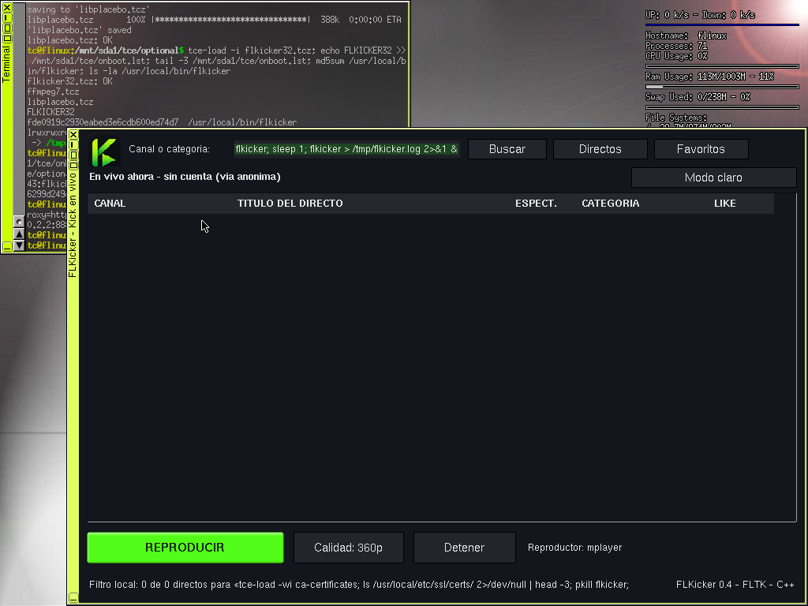
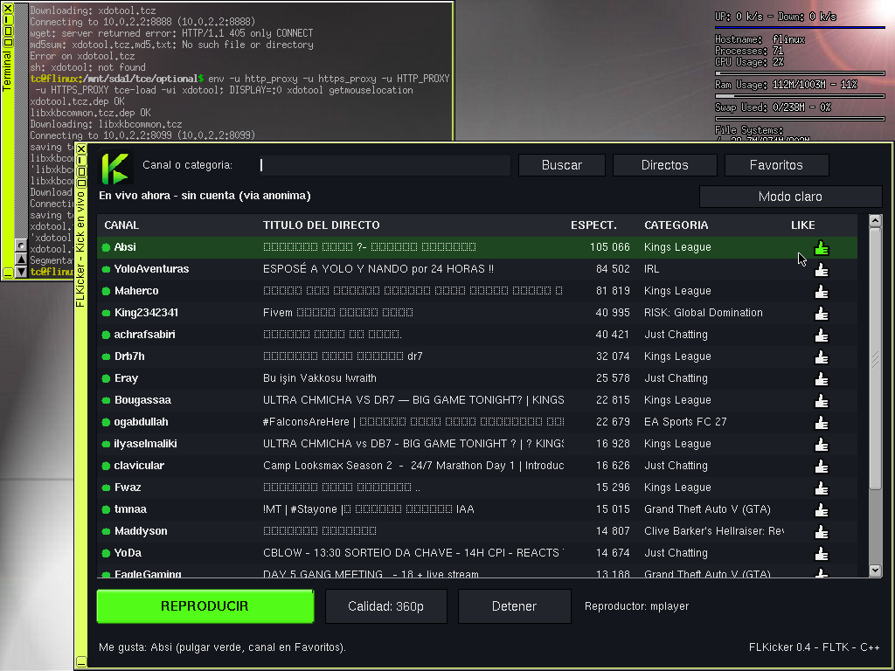
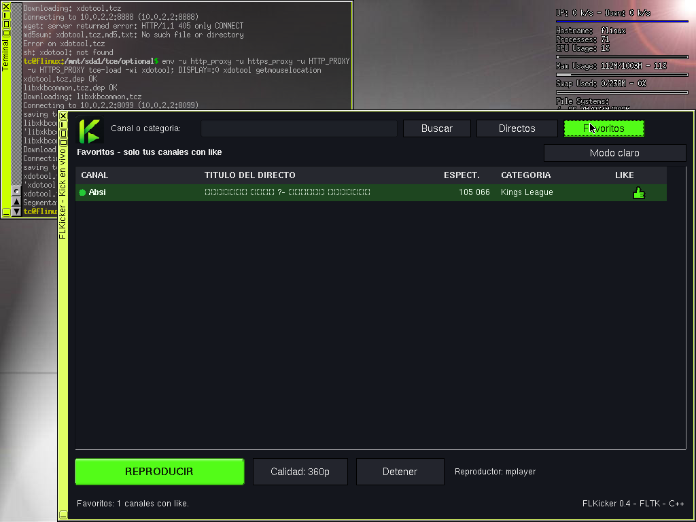
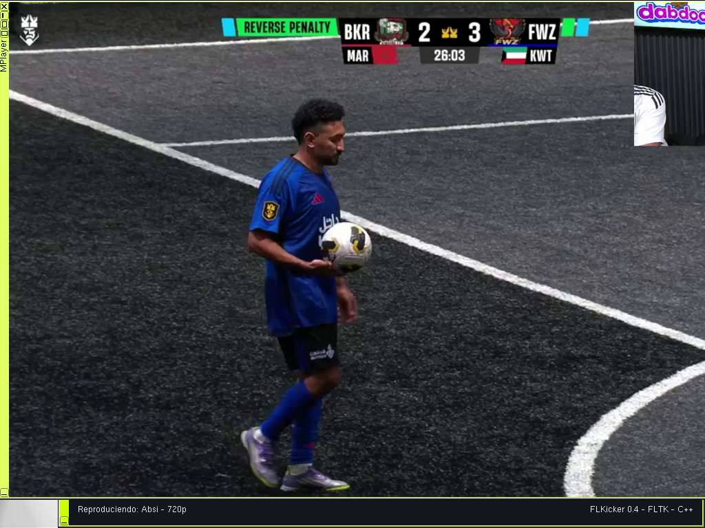
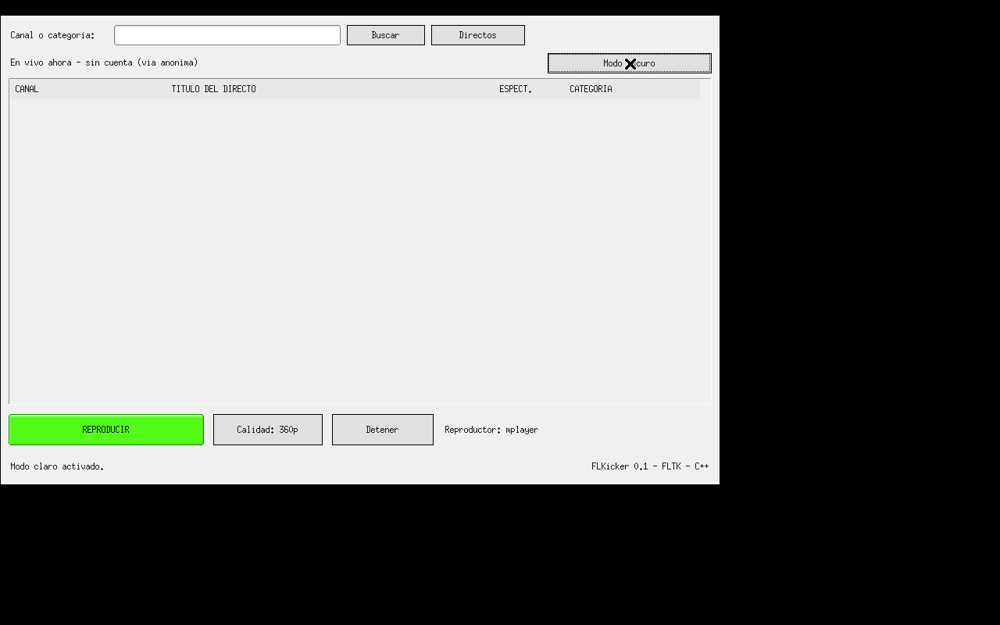
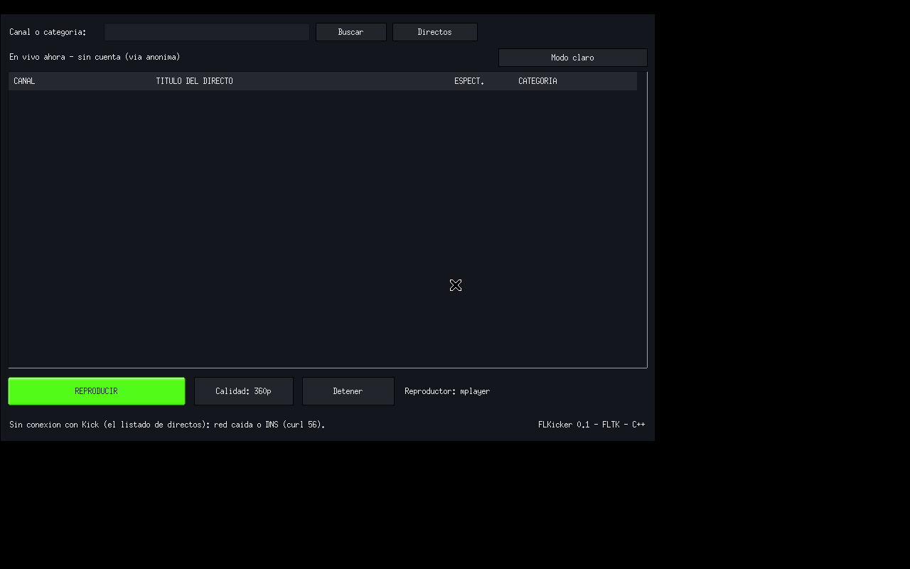

# FLKicker 0.7 — 32 bits

Cliente de Kick para Tiny Core / FLinux de 32 bits. Escrito en C++ con FLTK.


## Qué hace

FLKicker te permite ver directos de Kick sin necesidad de cuenta ni navegador:

- Lista los canales en vivo
- Busca canales por nombre
- Marca favoritos con 👍
- Reproduce en 160p–720p con mplayer
- Modo claro y modo oscuro

## Guía paso a paso

### 1. Instalar

Descarga los 3 archivos del repo (`flkicker32.tcz`, `.dep`, `.md5.txt`), verifica y copia a tu `tce/optional/`:

```
md5sum -c flkicker32.tcz.md5.txt
cp flkicker32.tcz /etc/sysconfig/tcedir/optional/
tce-load -i flkicker32.tcz
```

### 2. Abrir

Ejecuta `flkicker` en terminal o desde el wbar. Verás la lista de canales en vivo:



### 3. Buscar un canal

Escribe en el campo de búsqueda. Te muestra sugerencias mientras escribes; con Enter verifica el nombre exacto.

### 4. Marcar favorito

Toca el 👍 de un canal para guardarlo:



Tus favoritos se guardan en `~/.flkickerrc` y persisten entre reinicios.

### 5. Ver favoritos

Pulsa el botón **Favoritos** para ver solo tus canales guardados:



### 6. Reproducir

Selecciona un canal y pulsa **REPRODUCIR**. Elige la calidad (160p–720p):



Mientras reproduce, la app se bloquea (solo **Detener** e **Info** disponibles).

### 7. Modo claro / oscuro

Cambia el tema con el botón **Modo claro/oscuro**:

| Claro | Oscuro |
|---|---|
|  |  |

## Cómo funciona (técnico)

- Se conecta a la API pública de Kick sin cuenta.
- Al reproducir, refresca el `playback_url` con token → `master.m3u8` → tubería `ffmpeg` → `mplayer -zoom`.
- Punto rojo = canal apagado en la búsqueda.
- Spinner verde en la K mientras carga.
- Config remota firmada con Ed25519.

### Dependencias

```
curl.tcz
json-c.tcz
mplayer-cli.tcz
ffmpeg4.tcz
libEGL.tcz
openssl.tcz
```

## Código fuente

`flkicker.cpp` — fuente completo en C++/FLTK.

## Licencia

GPL-3.0. Cliente no oficial, sin afiliación con Kick.

## Créditos y agradecimientos

- **Kick** — plataforma de streaming.
- **Facundo Adorno** — creador de FLTube, proyecto que inspiró este cliente.
- **AnddyCort** — creador de FLTV, proyecto inspirador.
- **Nico Lombardi** — creador de FLinux, la distro donde corre FLKicker.
- **Robert Shingledecker** — creador de Tiny Core Linux, base de FLinux.

Cliente no oficial, sin afiliación con Kick.
